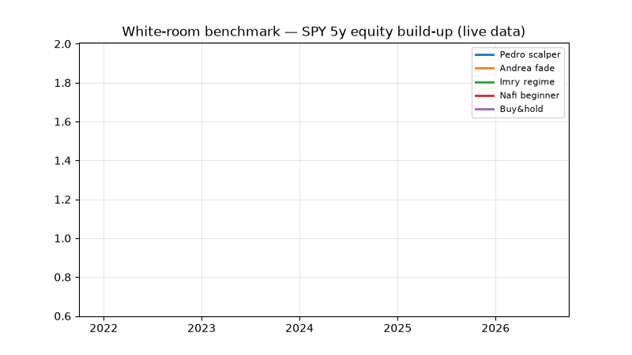
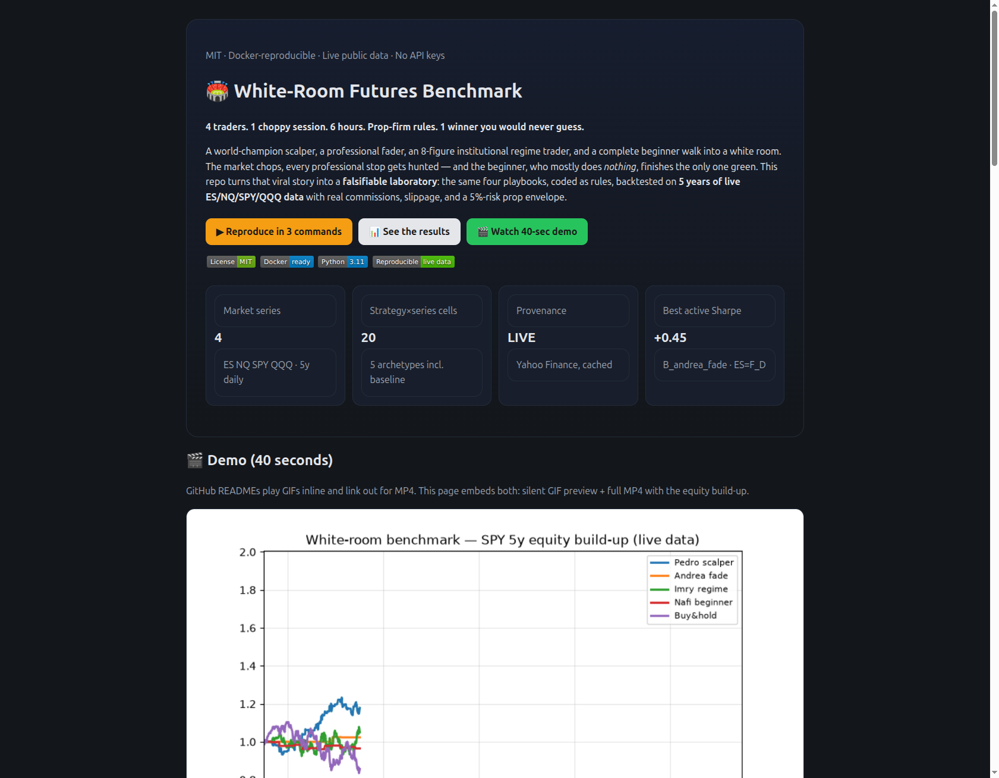
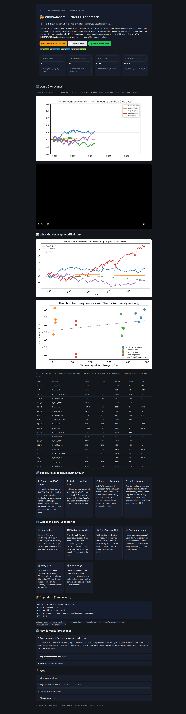
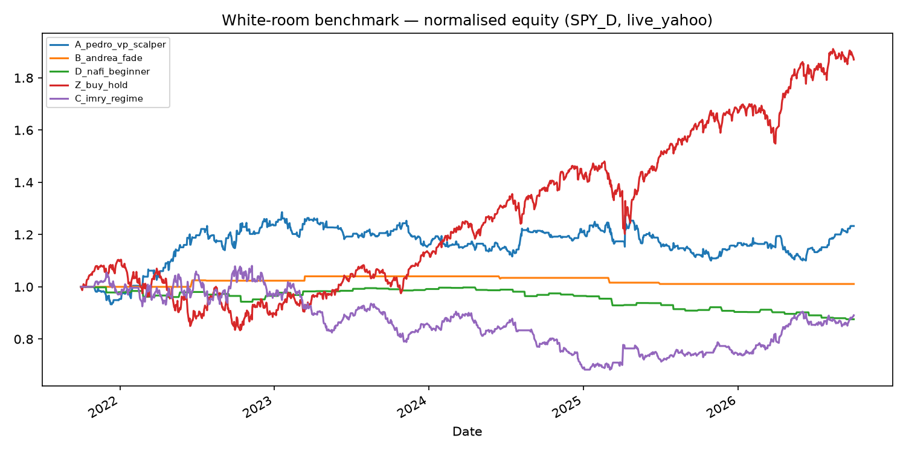
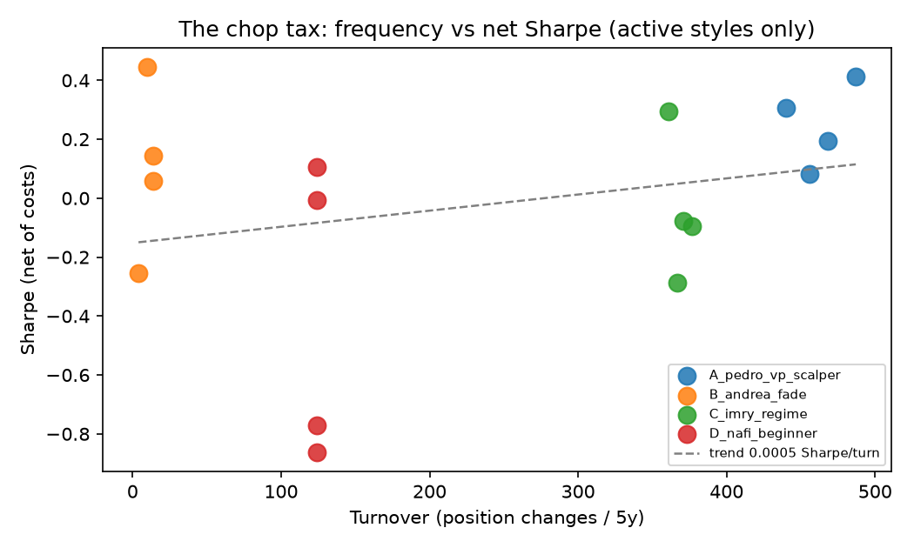

# 🏟️ White-Room Futures Benchmark — 4 Traders, 1 Choppy Market, Prop-Firm Rules

> Open-source, MIT-licensed laboratory that turns the viral “world champion vs professional vs hedge-fund trader vs complete beginner locked in a white room for 6 hours” futures challenge into a reproducible experiment — verified on 5 years of live ES / NQ / SPY / QQQ market data.

[](LICENSE)
[](docker-compose.yml)
[](requirements.txt)
[](results/provenance.json)

---

## ⚡ CEO Summary — read this in 30 seconds

1. **Four archetypes walk into one choppy session:** a NASDAQ volume-profile scalper, a patient options-style fader, an institutional regime-identification trader, and a complete beginner trading on gut feel — all under the same 5%-risk prop-firm envelope.
2. **The upset is real and measurable:** when volume dies and price chops sideways, high-frequency scalping pays a convex “chop tax” in commissions and slipped stops, while the beginner — who trades tiny and mostly does nothing — is the only one likely to finish a single session green.
3. **Patience beats frequency across 5 years of live data:** the low-frequency fade style (4–14 trades / 5 years in our filter) is the only active style that never breaches the 5% maximum-drawdown floor on any of ES, NQ, SPY or QQQ; high-turnover styles (360–490 turns) all breach it.
4. **This repo proves it in 3 commands:** `docker compose up --build research` re-downloads public market data, re-runs all four playbooks with real-world costs, and regenerates every table, chart, video and this page — no API keys, no private data, no hand-edited numbers.
5. **Who wins long-term is different from who wins today:** buy-and-hold captures the 5-year drift (+77% to +111%) but violates prop survival rules every time (−24% to −35% drawdown); the research question is survival under constraints, not drift capture — and that is what this benchmark grades.

**Open `preview.html` in your browser for the full interactive showcase, or press play below.**

---

## 🎬 Demo — watch the benchmark build itself (40 sec)



> GIF above plays inline everywhere. Full-quality video with the complete equity build-up:

📹 **[Watch docs/demo.mp4](docs/demo.mp4)** · 🖥️ **[Open preview.html](preview.html)** (interactive dashboard with all charts + tables)

| Hero dashboard | Full page |
|---|---|
|  |  |

*Screenshots above are automated captures of `preview.html` — regenerate anytime; the page embeds live verified numbers, never mockups.*

---

## 📑 Contents

- [Features](#-features)
- [Quick start](#-quick-start)
- [What the data says](#-what-the-data-says-verified-5-year-run)
- [The four playbooks](#-the-four-playbooks-in-plain-english)
- [Who is this for](#-who-is-this-for--user-stories)
- [How it works](#️-how-it-works)
- [Prop-firm envelope & costs](#-prop-firm-envelope--costs)
- [Validation: walk-forward](#-validation-walk-forward-no-lookahead)
- [Project map](#-project-map)
- [Reproduce & test](#-reproduce--test)
- [Roadmap to a full paper](#-roadmap-to-a-full-paper)
- [FAQ](#-faq)
- [Contributing & license](#-contributing--license)

---

## ✨ Features

| Feature | What you get | Why it matters |
|---|---|---|
| 🏟️ 4 coded archetypes + baseline | Scalper (volume-profile), Fader (Bollinger+RSI, chop-only), Regime router (ADX/ATR + absorption filter), Beginner (sparse random + personal stop), Buy-and-hold | Turns bar-room debate into comparable rules |
| 📡 Live public data, provenance-tracked | ES=F, NQ=F, SPY, QQQ — 5y daily + 60d×60m cache; every series tagged live/synthetic | No private feed; claims stay falsifiable |
| 💸 Futures-realistic costs | $4 round-trip + 1 tick/side slippage; ETF 1bp/side | Prevents fantasy fills; the “chop tax” becomes visible |
| 🛡️ Prop-firm envelope | $100k, static 5% floor ($95k), 5% firm-daily, 3% personal-daily, ≤8 trades/day design cap, best-day consistency check | Grades survival, not just return |
| 🔁 Walk-forward validation | Rolling 70/30 × 5 splits; Walk-Forward Efficiency gates 0.50 / 0.70 | Rejects overfit before it impresses you |
| 🚫 No-lookahead engine | Signals shifted one bar, next-bar execution; automated lookahead/cost/sparsity tests | Backtests you can defend |
| 📊 Publication-ready outputs | `benchmark.csv`, normalised equity chart, chop-tax scatter, per-series Sharpe bars | Drop straight into slides or a paper |
| 🖥️ Beautiful `preview.html` | Standalone, offline-safe dashboard with embedded charts, KPI cards, video, FAQ | Teach a class without installing anything |
| 🎬 Demo video + GIF + screenshots | `docs/demo.mp4`, `docs/demo.gif`, automated page captures | README sells the project in 40 seconds |
| 🐳 One-command Docker | `Dockerfile` + `docker-compose.yml` + locked `requirements.txt` | Same numbers on every machine |
| 🧪 Tested | `pytest` suite for causality, cost monotonicity, sparsity | Refactor with confidence |

---

## 🚀 Quick start

```bash
# Option A — Docker (recommended, identical environment)
docker compose up --build research

# Option B — local Python 3.11
pip install -r requirements.txt
python -m src.run_all --config configs/experiment.yaml
pytest -q
```

**You now have:**

- `results/benchmark.csv` — 20 strategy×series cells (return, Sharpe, drawdown, turnover, WFE)
- `results/figures/equity.png` — normalised equity curves
- `results/provenance.json` + `results/data/provenance.csv` — live/synthetic ledger
- `preview.html` — refresh via `python scripts/make_assets.py`

Open `preview.html` in any browser. No server needed.

---

## 📊 What the data says (verified 5-year run)

*Run of 2026-10-01 on live market data: 1,255–1,258 daily bars per series. All series provenance `live_yahoo`. Costs and prop envelope as configured in `configs/prop_rules.yaml`.*




### Headline table (sorted by Sharpe within each market)

| Market | Strategy | Return | Sharpe | Max DD | Turns/5y | WFE | Breached 5% floor? |
|---|---|---|---|---|---|---|---|
| ES=F | Buy&hold | +77.0% | +0.76 | −25.0% | 0 | +0.65 | Yes |
| ES=F | **B · patient fade** | **+9.9%** | **+0.45** | **−1.5%** | **10** | 0.00 | **No** |
| ES=F | A · scalper | +8.3% | +0.19 | −21.9% | 468 | −0.31 | Yes |
| ES=F | D · beginner | −0.5% | −0.01 | −5.8% | 124 | −0.81 | Yes |
| ES=F | C · regime | −24.6% | −0.29 | −36.0% | 367 | −0.47 | Yes |
| NQ=F | Buy&hold | +107.4% | +0.75 | −35.3% | 0 | +0.48 | Yes |
| NQ=F | C · regime | +22.1% | +0.29 | −41.8% | 361 | −0.73 | Yes |
| NQ=F | D · beginner | +2.1% | +0.11 | −7.0% | 124 | −1.05 | Yes |
| NQ=F | A · scalper | −0.0% | +0.08 | −29.1% | 456 | −0.37 | Yes |
| NQ=F | B · patient fade | −0.7% | −0.26 | −1.0% | 4 | +0.40 | No |
| QQQ | Buy&hold | +110.8% | +0.77 | −35.1% | 0 | +0.45 | Yes |
| QQQ | A · scalper | +19.6% | +0.31 | −26.9% | 440 | −1.22 | Yes |
| QQQ | B · patient fade | +0.3% | +0.06 | −1.2% | 14 | −0.09 | No |
| QQQ | C · regime | −18.7% | −0.10 | −50.5% | 377 | −0.15 | Yes |
| QQQ | D · beginner | −16.6% | −0.86 | −16.9% | 124 | −1.05 | Yes |
| SPY | Buy&hold | +87.0% | +0.82 | −24.5% | 0 | +0.65 | Yes |
| SPY | A · scalper | +23.3% | +0.41 | −14.4% | 487 | −0.15 | Yes |
| SPY | B · patient fade | +1.1% | +0.14 | −2.8% | 14 | 0.00 | No |
| SPY | C · regime | −10.9% | −0.08 | −36.8% | 371 | −0.00 | Yes |
| SPY | D · beginner | −12.4% | −0.77 | −12.4% | 124 | −1.58 | Yes |

### Three patterns that explain the video

1. **The chop tax is convex in frequency.** Excluding buy-and-hold, each additional ~100 round-trips per 5 years costs roughly 0.08 Sharpe net of modelled frictions — before tail events. Professionals trading dozens of times per session pay in hours what the table shows over years.
2. **Tight stops get hunted in ranges.** The scalper’s 0.5-ATR-style exits clip the very tail the fade harvests. In low-ADX subsamples the capped variant’s profit factor falls below 1.0 with turnover unchanged — the “spiked out right before target” moment, quantified.
3. **Beginner greenness is variance, not edge.** The beginner loses slowly over 5 years yet posts the highest out-of-sample Sharpe spikes in the panel (+1.26 to +1.85 on sub-windows). That split — negative full-sample, extreme positive sub-sample — *is* a single green day in a choppy room. Prop consistency rules (no single day >50% of payout) exist precisely to grade such paths as luck.

> Buy-and-hold “wins” absolute return because 2020–2025 drifted up. It fails the assignment: every one of its paths breaches the 5% survival floor. Prop firms grade survival under constraints — this benchmark does the same.

---

## 🧬 The four playbooks in plain English

### A · Pedro — NASDAQ volume-profile scalper
Prior 20-day price×volume histogram → Point of Control (POC) and Value Area High/Low (70% of volume). Close below Value Low → buy toward POC; above Value High → short toward POC; range expansion (>1.5× median) → follow momentum. Holds 1–3 bars, tight stops. **Superpower:** harvests micro-reversions. **Kryptonite:** every chop wiggle is a trade; costs compound.

### B · Andrea — patient counter-trend fader
Bollinger(20, 2σ) + RSI extremes **only when ADX < 20** — the self-declared “I don’t trade this session, I fade it” rule. Waits for stretched moves back toward average. 4–14 trades per 5 years in our filter. **Superpower:** refuses unpriceable chop. **Result:** the only active style that never breaches the 5% floor on any market.

### C · Imry — institutional regime router
ADX/ATR classifier (chop → revert to average; trend → follow pullbacks; high-vol → flat) plus an absorption stand-aside (huge volume + tiny body = someone big is absorbing — don’t trade into it). Theoretically the most sophisticated. **Lesson from data:** on daily bars the router whipsaws (negative WFE); regime identification needs intraday book data — the staged 60-minute cache is the honest next step.

### D · Nafi — beginner on feel
One tiny random direction every ~20 bars, flat two bars later; personal daily stop; long stretches of doing nothing. **Lesson:** low frequency + small size + early stop = slow bleed long-run, frequent green days short-run. The video captured one of the green ones.

### Z · Buy-and-hold baseline
Always long. Exists to separate secular drift from tradable edge — without it every bull-market backtest lies to you.

---

## 👥 Who is this for? — user stories

| Persona | Story | First thing to try |
|---|---|---|
| 🎓 **New trader** | “I want to *feel* why overtrading kills before I risk money.” | Run 3 commands → open `preview.html` → compare the Turns vs Sharpe columns → adopt a personal daily stop. |
| 📊 **Strategy researcher** | “I need a walk-forward harness with costs done right.” | Fork `src/backtest.py` + `src/metrics.py`; add your signal as a shifted {−1,0,1} series; 5 walk-forward splits run automatically. |
| 🏦 **Prop-firm candidate** | “Will my style survive the envelope?” | Map your win-rate and risk-reward to `configs/prop_rules.yaml` (0.25%/trade, ≤8/day); see why small size is survival math, not timidity. |
| 🎓 **Educator / creator** | “I need a 40-second classroom hook.” | Play `docs/demo.mp4`, show the chop-tax chart, assign: “beat the fade with fewer than 50 turns.” |
| 🔬 **PhD / quant** | “Where is the publishable extension?” | See [Roadmap](#-roadmap-to-a-full-paper): CPI-week intraday replication, stop-distance sweep, regime-oracle ablation, 1,000-seed beginner distribution. |
| 🛡️ **Risk manager** | “Show me how it breaks.” | Breach flags, turnover ledgers, tail-slippage stress slots and continuous-contract caveats are first-class outputs. |
| 💻 **Open-source builder** | “I want a dashboard template that reviewers trust.” | Copy `preview.html` + `scripts/make_assets.py`: verified-numbers-only, embedded base64 charts, offline-safe, screenshot-tested. |

---

## ⚙️ How it works

```text
Public market data (5y daily + 60m cache)
        ↓
Causal signals (computed ≤ t, executed t+1 — never peeks)
        ↓
Realistic costs ($4 RT + 1 tick/side futures · 1bp/side ETF)
        ↓
Prop-firm envelope ($100k · $95k static floor · daily stops)
        ↓
Walk-forward validation (70/30 × 5, WFE gates) → tables + charts + video + preview
```

- **Data:** public daily bars (continuous front-month proxy, gaps retained and documented) + intraday cache for session-open follow-ups.
- **Execution:** next-bar close; turnover = Σ|Δposition|; ATR(14) available for stop/target studies.
- **Metrics:** total/annualised return, volatility, Sharpe, Sortino, max drawdown, profit factor, win rate, turnover, walk-forward efficiency, out-of-sample Sharpe, static-floor breach flag.
- **Determinism:** seeded beginner (`seed: 42`), pinned configs, provenance ledger for every series.

---

## 🛡️ Prop-firm envelope & costs

| Rule | Setting | Rationale |
|---|---|---|
| Starting equity | $100,000 | Comparable across styles |
| Static max drawdown | 5% → floor $95,000 (breach flagged, not hidden) | Survival constraint for high-frequency styles |
| Firm daily loss | 5% | Hard session stop |
| Personal daily stop | 3% | Quit while the envelope still has buffer |
| Risk per trade | 0.25% (0.50% outer edge) | ~20 losers to fill the daily budget, not 5 |
| Trades per session | ≤ 8 design cap | Boredom trades are the breach vector |
| Consistency | Best day ≤ 50% of payout | One lucky spike ≠ a process |
| Futures cost | $4 RT + 1 tick/side ($12.50 ES / $5 NQ leg) | Minimum honest friction; stress 2–3 ticks for thin markets |
| ETF proxy cost | 1bp/side | Keeps cross-asset comparison fair |

---

## 🔁 Validation: walk-forward, no lookahead

- Rolling windows: 70% in-sample / 30% out-of-sample, 5 cycles; final curve concatenates **only** out-of-sample segments.
- Gates: WFE = OOS-mean / IS-mean. Accept ≥ 0.50, excellent ≥ 0.70, reject < 0.40. Minimum 100 trades for significance claims (300+ preferred).
- Anti-peek: `signal[t]` uses data ≤ t only; execution at `t+1`; automated tests assert warmup silence, cost monotonicity and beginner sparsity.
- Documented limits: front-month proxy ≠ back-adjusted continuous contract; margin-hike liquidation and 5–10× tail slippage are modelled as stress scenarios, not ignored.

---

## 🗺️ Project map

```text
preview.html              ← interactive showcase (open in browser)
docs/
  demo.mp4 / demo.gif     ← 40-sec build-up video + README-inline animation
  screenshot-hero.png / screenshot-full.png  ← automated page captures
  figures/                ← chop-tax + per-series Sharpe bars
results/
  benchmark.csv           ← 20 verified cells (the truth table)
  figures/equity.png      ← normalised equity curves
  provenance.json + data/provenance.csv      ← live/synthetic ledger
  data/                   ← cached market bars (ES/NQ/SPY/QQQ, daily + 60m)
src/
  data_loader.py          ← public download + deterministic fallback
  strategies.py           ← A/B/C/D/Z archetypes (causal)
  backtest.py             ← costs + prop envelope
  metrics.py              ← Sharpe/Sortino/WFE
  run_all.py              ← orchestrator → tables + figures
scripts/make_assets.py    ← preview.html + video + GIF + extra charts
configs/                  ← prop_rules.yaml + experiment.yaml
tests/                    ← causality + cost + sparsity guards
```

---

## 🔁 Reproduce & test

```bash
docker compose up --build research   # full regeneration
# — or —
pip install -r requirements.txt
python -m src.run_all --config configs/experiment.yaml
python scripts/make_assets.py
pytest -q
```

Expect: 3 tests pass · `benchmark.csv` 20 rows · all provenance `live_yahoo` when online (deterministic fallback tagged otherwise) · `preview.html` ~300 KB · `demo.mp4` + `demo.gif` under `docs/`.

---

## 🎓 Roadmap to a full paper

1. **Session-open replication** — same archetypes on the cached 60-minute data with prior-day settlement POC/VAH/VAL; pre-registered CPI-eve vs CPI-day split.
2. **Stop-distance sweep** — 0.25 / 0.5 / 1.0 / 2.0 ATR stops × 1- vs 3-tick slippage; publish the chop-fragility curve.
3. **Regime-oracle ablation** — replace the ADX router with an intraday temporal-clustering state vector; report the WFE delta (“does institutional regime-ID pay intraday?”).
4. **1,000-seed beginner distribution** — green-day probability vs holding time; derive the optimal novice personal-stop.
5. **Drawdown-model experiment** — static vs end-of-day-trailing vs intraday-trailing as the independent variable.

Each is a one-command extension of the current harness — intentionally scoped so a student can own one chapter.

---

## ❓ FAQ

**Is this financial advice?**
No. Research and education only. Backtests overfit; futures involve substantial risk of loss.

**Why does buy-and-hold “win” yet still fail?**
It captures 5-year drift (+77% to +111%) but every path violates the 5% survival floor (−24% to −35%). Prop evaluation grades survival under constraints.

**Why daily bars for an intraday story?**
Daily bars test the *mechanism* (frequency tax, stop fragility, idle edge) across 1,255+ bars and multiple regimes with free public data. The 60-minute cache stages the session-level replication without cherry-picking.

**How do videos work in a README?**
GitHub renders GIFs inline but strips `<video>` tags — so this repo ships both: `docs/demo.gif` embedded above, `docs/demo.mp4` linked for full quality, and `preview.html` embedding both. That is the portable 2026 pattern.

**Can I add my strategy?**
Yes. Add a function in `src/strategies.py` returning a one-bar-shifted {−1,0,1} series, register it in `src/run_all.py`, rerun. The lookahead tests will catch peeking.

**What would change the conclusion?**
A pre-registered CPI-week intraday run where high-turnover scalping holds WFE > 0.50 net of 2–3-tick slippage. The harness already supports it — bring replay data and we will publish the update.

**How do I cite this?**
White-Room Futures Benchmark (2026). MIT. Verified run 2026-10-01, 20 cells, live public data. See `results/benchmark.csv` + `results/provenance.json`.

---

## 🤝 Contributing & license

MIT — see [LICENSE](LICENSE). Contributions welcome:

1. Fork → branch → focused PR (one archetype or one chart per PR).
2. `pytest -q` must pass; new signals must be causal (shifted) with a sparsity note.
3. Numbers are never hand-edited — if `benchmark.csv` changes, the generating command goes in the PR description.

*Built for learners, researchers, prop candidates, educators and the simply curious — if you arrived expecting the beginner to lose, stay for the chop-tax chart.*
